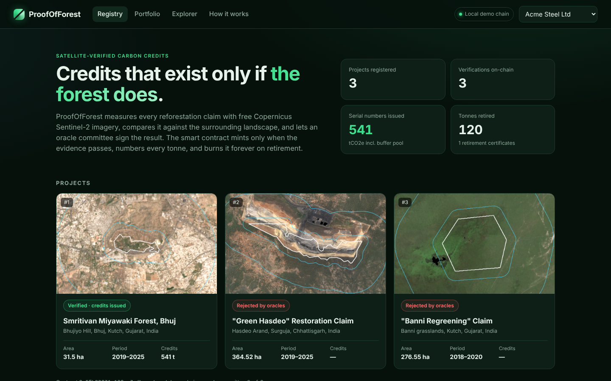
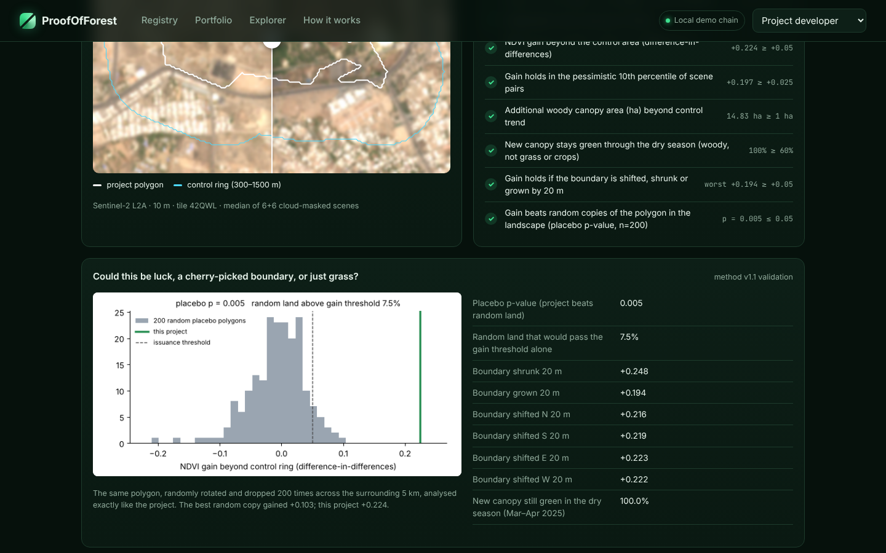
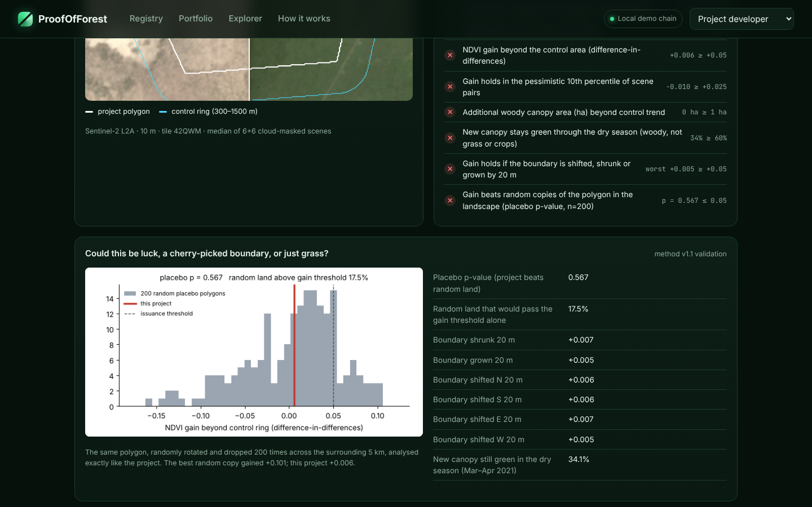
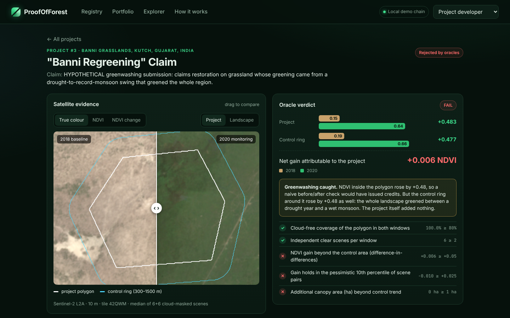
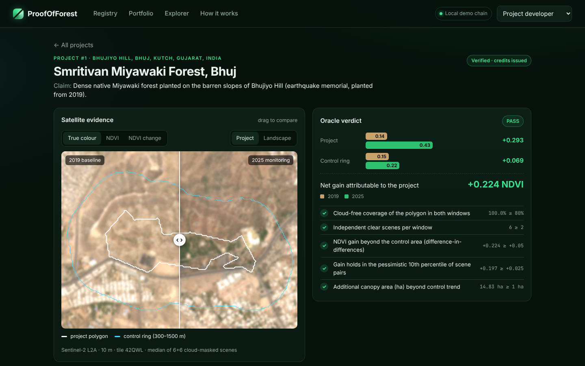
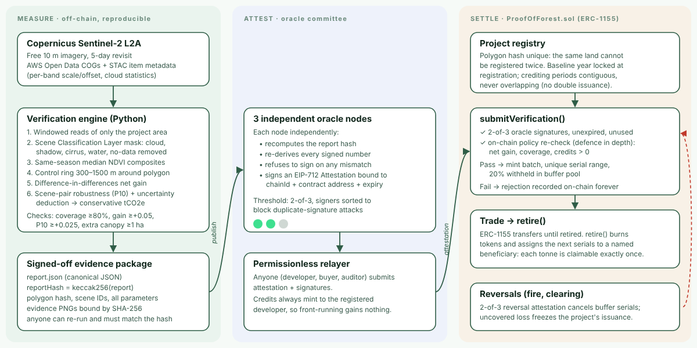

<div align="center">

# 🌳 ProofOfForest

**Carbon credits that exist only if the forest does.**

Free Copernicus Sentinel-2 imagery measures every reforestation claim against its surrounding landscape. A 2-of-3 oracle committee signs the result. An ERC-1155 contract mints serial-numbered credits only when the evidence passes, and burns them forever on retirement.

*IEEE ClimateChain Global Hackathon · Track: Carbon Markets & Emissions Transparency*

[Demo video](#demo) · [How it works](#how-it-works) · [Run it in 2 minutes](#quick-start) · [Threat model](docs/THREAT_MODEL.md) · [Architecture](docs/architecture.svg)

</div>



## The problem

Voluntary carbon markets run on trust. Investigations of major registries have found forest credits issued for protection or growth that never happened, the same tonne counted by more than one party, and verification that depends on infrequent, paid, site-visit audits. Buyers cannot check the evidence themselves, and honest small projects (a village, a school, a city forest) cannot afford the audit at all.

Two failure modes matter most for reforestation credits:

1. **Phantom or exaggerated growth.** The trees are not there, or a wet year makes everything look greener.
2. **Double counting.** The same tonne is sold twice, or claimed by two buyers, because serial numbers and retirements live in private databases.

## The solution

ProofOfForest replaces "trust the auditor" with evidence anyone can re-run and a contract anyone can inspect.

| Layer | What it does | Why it is hard to fool |
|---|---|---|
| **Measure** (Python engine) | Reads only the project's pixels from every Sentinel-2 L2A scene in the same season of two years, masks clouds/shadow/water, builds median NDVI composites, and compares the project polygon with a **control ring** 300–1500 m around it (difference-in-differences). | Region-wide effects (monsoon, irrigation, sensor changes) hit project and control alike and cancel. The gain must also survive the pessimistic 10th percentile of all scene pairs. |
| **Attest** (oracle committee) | Three independent oracle nodes each **re-run the whole satellite analysis from raw ESA data**, refuse unless every number matches, and sign an EIP-712 attestation with their own key. | 2-of-3 threshold, domain-separated, expiring, single-use. One stolen key cannot mint. |
| **Settle** (`ProofOfForest.sol`) | Verifies signatures, **re-checks the numbers against on-chain policy**, mints ERC-1155 credits with a unique serial range, withholds 20% in a buffer pool, records rejections forever, and burns credits on `retire()`. | Each serial is assigned exactly once. Retired tonnes cannot move again. Same land cannot be registered twice; crediting periods cannot overlap. |

## Real results on real satellite data

All three case studies run the same unmodified method on public Sentinel-2 L2A data (6 cloud-masked scenes per window, 10 m pixels). Reports, scene IDs and evidence images are committed in [`reports/`](reports).

| Case | Claim | Project ΔNDVI | Control ΔNDVI | **Net gain** | Placebo p | Dry-season persistence | Verdict |
|---|---|---|---|---|---|---|---|
| **Smritivan, Bhuj (Gujarat)** · 31.5 ha · Mar–Apr 2019 → 2025 | Miyawaki forest planted on the barren slopes of Bhujiyo Hill | +0.294 | +0.069 | **+0.224** | **0.005** (beats all 200 random copies) | 100% | ✅ **541 tCO2e** issued (109 to buffer) |
| **"Green Hasdeo" (Chhattisgarh)** · 365 ha · Jan–Feb 2019 → 2025 | *Hypothetical fraud:* "reforestation" on land actually cleared for an open-cast coal mine | −0.466 | +0.018 | **−0.484** | 1.0 | 21% | ❌ Rejected on-chain |
| **"Banni Regreening" (Kutch)** · 277 ha · Oct–Nov 2018 → 2020 | *Hypothetical greenwashing:* takes credit for greening caused by a drought year followed by a wet monsoon | **+0.483** | +0.477 | **+0.006** | 0.567 | 34% (grass) | ❌ Rejected, although a naive before/after check would have **passed** |

The Banni case is the point: NDVI inside the polygon jumped by almost half, and a simple "before vs after" verifier would have issued hundreds of credits. ProofOfForest looks at the landscape around it, sees the same jump everywhere, and credits nothing. It fails four independent ways: no gain beyond the control ring, no better than random land (placebo p = 0.57), the greening browns off again in the next dry season (grass, not trees), and no robust scene-pair gain.

<p align="center"> </p>

**Independently reproduced.** Each report was re-run from scratch, with an empty cache, straight from the ESA archive, by the same command every oracle runs before signing (`python -m pof_engine reproduce`). All three came back identical: every number, check and verdict.

<p align="center"> </p>

## Demo

▶ **Demo video (under 5 min):** `video/ProofOfForest-demo.mp4` (also linked on the Devpost page)

The video walks through: the three projects → satellite evidence (drag-to-compare before/after) → submitting signed attestations (one mints, two are rejected on-chain) → selling credits to a buyer → retiring them with a beneficiary → the retirement certificate → looking up a serial number in the public explorer.

## How it works



### 1. Measurement: `POF-NDVI-DiD-v1.1` ([engine/pof_engine/verify.py](engine/pof_engine/verify.py))

1. **Scene discovery** straight from the public `sentinel-cogs` bucket (AWS Open Data). No API keys. Each scene's STAC item gives cloud statistics and the band scale/offset.
2. **Windowed reads**: only the pixels around the project are downloaded (a few MB per scene).
3. **Reflectance harmonisation**: scenes processed with baseline ≥ 04.00 carry a +1000 DN offset. Applying it twice (or never) fakes a −0.1 / +0.1 reflectance trend; the engine applies it exactly once using the item's `earthsearch:boa_offset_applied` flag.
4. **Cloud masking** with the Sentinel-2 Scene Classification Layer: only vegetation, bare soil and unclassified pixels count (no cloud, shadow, cirrus, water, no-data).
5. **Composites**: the clearest ≤ 6 scenes over the polygon per window, per-pixel median NDVI. Baseline and monitoring windows must cover the same months (phenology).
6. **Difference-in-differences**: `net gain = (project NDVI change) − (control ring NDVI change)`.
7. **Robustness**: DiD recomputed for every baseline × monitoring scene pair; the 10th percentile must stay ≥ +0.025.
8. **Woody canopy only**: trees stay green through the dry season; rain-fed grass and crops do not. A pixel only counts as canopy if it is above NDVI 0.40 in the monitoring window **and** in the following dry season, and ≥ 60% of the new canopy must persist.
9. **Boundary sensitivity**: the polygon is shrunk, grown and shifted N/S/E/W by 20 m (two pixels, typical digitising/GPS error). The gain must hold in every variant, so the verdict never hinges on exactly where the line was drawn.
10. **Placebo test**: the same polygon is randomly rotated and dropped 200 times in the surrounding 5 km (seeded by the polygon hash, so reproducible) and analysed exactly like the project. The project must out-gain at least 95% of them (p ≤ 0.05). This answers "was this boundary picked because it happened to green?": random land around Smritivan peaks at +0.10, the project is +0.22.
11. **Credits (conservative)**: additional *woody* canopy area (beyond the control trend) × 7 tCO2e/ha/yr × years × (1 − uncertainty deduction). The deduction is the relative spread between median and P10 scene-pair gain, bounded to 10–50%. NDVI only decides *where* new tree canopy exists, never how many tonnes; the removal factor is a per-ecozone parameter inside the signed report, so a registry can substitute its own field-calibrated value.
12. **Checks**: coverage ≥ 80%, ≥ 2 clear scenes per window, net gain ≥ +0.05, P10 ≥ +0.025, additional woody canopy ≥ 1 ha, dry-season persistence ≥ 60%, boundary-variant gain ≥ +0.05, placebo p ≤ 0.05. All must pass.
13. **Report**: canonical JSON with every parameter, scene ID and result, SHA-256 of every evidence image, and `reportHash = keccak256(report)`. Anyone can re-run and must reproduce the hash.

### 2. Attestation: [oracle/node.ts](oracle/node.ts), [oracle/attestation.ts](oracle/attestation.ts)

Each oracle is a separate operator with its own key on its own machine. Before signing, the node:

1. **re-runs the entire satellite analysis from the raw ESA archive** (`python -m pof_engine reproduce`) and refuses unless every result, check and verdict matches the published report, and the method parameters are the standard ones;
2. recomputes the report hash byte-for-byte and re-derives every signed field (never trusting the report's own summary);
3. checks on-chain that the project is registered with exactly this polygon and that its key holds `ORACLE_ROLE`.

It writes one signature file. Anyone can then combine the files and relay them; the combiner checks every file signs the identical attestation.

```bash
ORACLE_PRIVATE_KEY=0x… npx ts-node oracle/node.ts sign   --report reports/smritivan-bhuj/report.json \
    --project-id 1 --expiry 1767225600 --chain-id 80002 --contract 0x… --rpc https://rpc-amoy.polygon.technology
PRIVATE_KEY=0x…        npx ts-node oracle/node.ts submit --report reports/smritivan-bhuj/report.json \
    --chain-id 80002 --contract 0x… --rpc https://rpc-amoy.polygon.technology
```

So a lazy or compromised oracle cannot simply co-sign: it has to agree with two independent recomputations from public data, and the contract still re-checks the numbers. In the hackathon demo the three nodes run on one laptop; in production they would be a registry, an auditor and a university remote-sensing lab (the admin adds and removes `ORACLE_ROLE` holders, behind a multisig and timelock). The signed message:

```
Attestation(uint256 projectId, bytes32 geometryHash, bytes32 reportHash, uint16 baselineYear,
            uint16 monitoringYear, int32 ndviBaseline, int32 ndviMonitoring, int32 controlDelta,
            int32 netGain, uint32 validCoverageBps, uint32 canopyGainHa100, uint64 creditTonnes,
            bool passed, uint64 expiry)
```

with EIP-712 domain `{name: "ProofOfForest", version: "1", chainId, verifyingContract}`.

### 3. Settlement: [contracts/ProofOfForest.sol](contracts/ProofOfForest.sol)

* `registerProject(name, geometryHash, startYear, metadataURI)`: polygon hash must be unique; the baseline year is locked.
* `submitVerification(attestation, signatures)`: **anyone** may relay. Requires ≥ 2 distinct oracle signatures (sorted, so no duplicates), an unused report, an unexpired attestation, the registered polygon, and a crediting period that starts exactly where the last one ended. Then the contract **re-checks the numbers against its own policy** (min net gain, min coverage, credits > 0). Pass: a new batch (token id) is minted to the developer with a contiguous serial range; 20% is withheld in the buffer pool. Fail: the rejection is stored on-chain and the developer's rejection count goes up.
* `retire(batchId, amount, beneficiary, purpose)` / `retireFrom(...)`: burns the tokens and assigns the next `amount` serials of the batch to the beneficiary. A retirement certificate is a permanent on-chain record.
* `serialInfo(serial)`: any serial resolves to Outstanding / Retired (with certificate id) / Buffer / Cancelled in O(log n).
* `recordReversal(reversal, signatures)`: if a later attestation shows forest loss, buffer serials are cancelled; any shortfall freezes the project's issuance.
* `pause()` stops issuance only. Retirement can never be paused.

Serial labels look like `POF-2025-P001-0000042` (vintage, project, global serial).

## Quick start

Requirements: Node.js 18+ (and Python 3.10+ only if you want to re-run the satellite analysis).

```bash
git clone <this repo> && cd proof-of-forest
npm install            # also installs the frontend
npm test               # 41 contract, oracle-node and end-to-end tests
npm run demo           # local chain + contract + 3 projects + dApp at http://localhost:5173
```

In the demo, the account menu (top right) switches between **Project developer**, **Acme Steel Ltd** (a buyer) and an **Independent relayer**, so you can play every role without a wallet.

### Re-run the satellite verification yourself

```bash
pip install -r engine/requirements.txt
npm run verify:all     # or: PYTHONPATH=engine python -m pof_engine verify projects/banni-rain.json
cd engine && python -m pytest -q   # 11 engine tests on synthetic scenes
python -m pof_engine reproduce ../reports/smritivan-bhuj/report.json   # independent re-run, what oracles do
```

Each run downloads ~100 MB of public imagery and takes 1–2 minutes per project. `python -m pof_engine check-hash reports/<id>/report.json` verifies a published report.

### Deploy to Polygon Amoy (or Sepolia)

```bash
cp .env.example .env        # put a throwaway testnet private key in PRIVATE_KEY
npm run deploy:amoy         # deploys, registers the 3 projects, oracle committee signs the reports
npm run frontend            # open http://localhost:5173 with MetaMask on Amoy
```

The first testnet deploy generates three oracle keys into `.env.oracles` (git-ignored). The deployment record (contract address, transactions, signed attestations) is written to `frontend/public/deployments/<chainId>.json`.

**Testnet deployment:** see [`frontend/public/deployments/`](frontend/public/deployments) for the live contract address and transaction hashes.

## Tests

| Suite | What it proves |
|---|---|
| `test/ProofOfForest.test.ts` (33) | registry, 2-of-3 signatures, tampering, cross-chain replay, report replay, expiry, crediting-period locks, on-chain policy re-check, buffer rounding, serial assignment, retire / retireFrom, pause semantics, reversals and shortfalls, plus a randomised invariant test (no serial ever assigned twice, supply always reconciles) |
| `test/EndToEnd.test.ts` (8) | the three **real** Sentinel-2 reports go through the oracle signer into the contract: Smritivan mints, Hasdeo and Banni are rejected; an edited report is refused; independent oracle nodes sign separately and anyone combines and relays; a node refuses when its own re-run disagrees or the on-chain polygon differs; mismatched or forged signature files cannot be combined |
| `engine/tests/test_verify.py` (11) | real growth passes; clearing, region-wide rain greening, seasonal grass (green, then brown in the dry season) and cloud-covered evidence are rejected; placebo and boundary checks; seasons must match; geometry hashes are canonical; uncertainty deduction is bounded; report hashes are reproducible and detect tampering; the oracle `reproduce` step catches any edited number or non-standard parameter |

Gas (Hardhat, optimizer on): `submitVerification` ≈ 213k–416k, `retire` ≈ 177k–232k, `registerProject` ≈ 146k–168k.

## Impact, users and scale

* **Who uses it.** Small reforestation developers (NGOs, farmer collectives, city forests) who cannot afford a traditional verification; corporate buyers who need claims that survive scrutiny; registries and auditors who want a cheap, automatic first screen; journalists and regulators who want to check a credit themselves.
* **Cost.** Verification uses free public data and runs in about 90 seconds on a laptop. Gas for issuance is a few hundred thousand gas, cents on an L2.
* **Scale.** Sentinel-2 covers every land surface every 5 days at 10 m. The engine reads only the pixels of each project, so thousands of projects can be re-checked every year, which also enables continuous permanence monitoring (reversals).
* **Adoption path.** (1) A screening tool for existing registries and buyers ("does this project's land actually look like this?"). (2) Oracle committee operated by independent parties (a registry, an auditor, a university remote-sensing lab). (3) Plug the ERC-1155 batches into existing on-chain carbon infrastructure and retirement aggregators.

## Honest limitations

NDVI locates new woody canopy; it does not weigh it. The tonnes come from a conservative, configurable removal factor rather than project-specific allometry or field plots (next step: GEDI canopy height and plot calibration). 10 m pixels under-credit very young plantations. The oracle node software is built for independent operators, but in this demo all three run on one laptop. The case-study polygons are digitised from imagery for demonstration (two are explicitly hypothetical fraud scenarios); the placebo and boundary tests exist precisely so that a hand-drawn boundary cannot manufacture a result. These figures are **method demonstrations, not certified offsets**. See [docs/THREAT_MODEL.md](docs/THREAT_MODEL.md) for the full list and mitigations.

## Repository layout

```
contracts/ProofOfForest.sol     ERC-1155 credits, oracle verification, serials, retirement, buffer pool
engine/pof_engine/              Sentinel-2 catalog, windowed COG reads, NDVI DiD method, evidence images
oracle/attestation.ts           report re-hashing + EIP-712 signing (2-of-3 committee)
oracle/node.ts                  independent oracle node: re-run from raw data, sign, combine, submit
projects/*.json                 project polygons and observation windows
reports/<id>/                   signed-off verification reports + evidence images (real data)
scripts/                        deploy, one-command demo, verify-all, frontend sync
frontend/                       React + ethers dApp (registry, evidence, portfolio, certificate, explorer)
test/                           Hardhat tests (unit, invariants, end-to-end on real reports)
docs/                           architecture diagram, threat model, Devpost text
video/                          demo video and narration script
```

## Credits

Contains modified Copernicus Sentinel-2 data (2018–2025), processed by ESA and distributed through the AWS Open Data Registry (Element 84 Earth Search COGs). Smart contracts use OpenZeppelin Contracts 5.1. MIT licensed.
